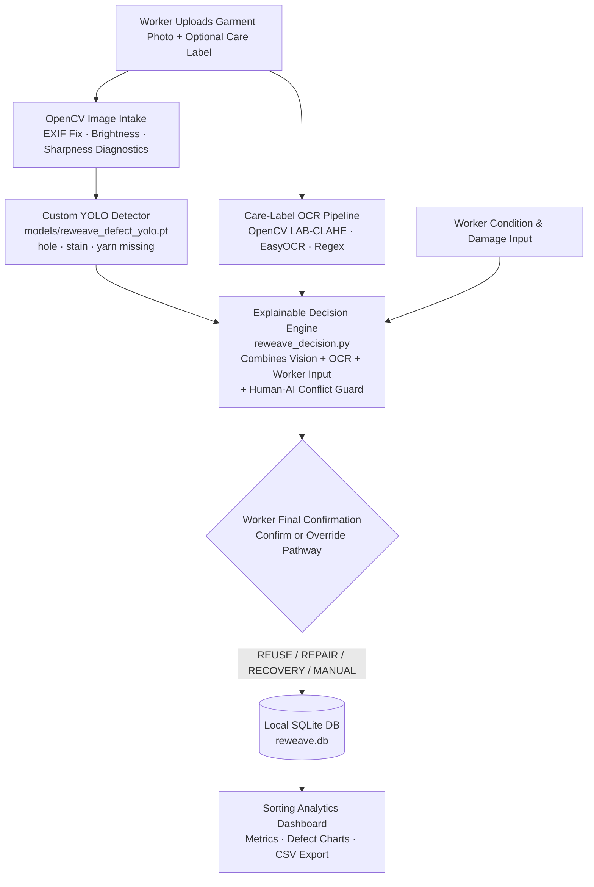

# 🧵 ReWeave AI — Circular Textile Intelligence

> **Human-in-the-loop textile sorting assistant for Innovate India 2026 (Sustainability & Green Technology)**  
> Helping textile sorting workers (such as in India's Panipat recycling ecosystem) inspect garment condition, read care labels, and prioritize **REUSE** and **REPAIR** before premature shredding or material recovery.

---

## 🎯 Problem & Core Design Principles

Post-consumer garments in India often face **premature mechanical shredding**, **blind fibre guesswork** when tags are missing, and inconsistent manual sorting. ReWeave AI augments—never replaces—workers using lightweight, free open-source AI:

- **Strict Scientific Honesty:** Ordinary RGB photos cannot identify chemical fibre blends. Missing or unreadable care labels remain strictly **`UNKNOWN`**.
- **Human-in-the-Loop Confirmation:** YOLO defect detections are **suggestions only**. Workers review evidence and explicitly confirm or override every final sorting pathway.
- **Human–AI Conflict Guard:** If a worker selects *"Ready to wear"* while YOLO detects a high-confidence visible defect (`hole`, `stain`, `yarn missing`), the engine pauses at **`MANUAL INSPECTION`** for a second visual check.

---

## 🏗️ System Architecture



---

## 📊 Verified Model Evaluation (Held-Out `test` Split)

Trained locally on **Apple Silicon M2 GPU (`MPS`)** using lightweight `yolo26n.pt` (20 epochs, `imgsz=640`, `batch=4`) on an audited **CC BY 4.0** textile defect dataset ([Roboflow Defect Detection](https://universe.roboflow.com/defects-zxmr5/defect-detection-xmqul), 1,248 images: 963 train / 227 val / 58 unseen test; 13 mixed polygon labels programmatically converted to enclosing YOLO bounding boxes before training).

| Evaluation Split | Images | Precision | Recall | mAP@50 | mAP@50-95 |
|---|---:|---:|---:|---:|---:|
| **Held-Out Test** | **58** | **81.5%** | **79.0%** | **81.1%** | **43.4%** |

**Per-class mAP@50-95:** `hole`: **52.7%** · `stain`: **47.4%** · `yarn missing`: **30.1%**  
*(Full machine-readable audit & evaluation reports are stored in `reports/dataset_audit.md` and `reports/model_evaluation.json`.)*

---

## 🛠️ Technology Stack (100% Free & Open-Source)

| Component | Technology | Role |
|---|---|---|
| Core Language | Python | Application & ML pipeline |
| Image Intake & Preprocessing | OpenCV (`cv2`), Pillow | EXIF fix, sharpness/brightness checks, LAB-CLAHE label enhancement |
| Visible Defect Detection | Ultralytics YOLO (`yolo26n`) | Bounding-box detection for `hole`, `stain`, `yarn missing` |
| Care-Label Reading | EasyOCR + Regex | Fibre composition (`% + fibre`) & care instructions (`UNKNOWN` fallback) |
| Web Application | Streamlit | Accessible browser UI for desktop & mobile devices |
| Storage & Analytics | SQLite + Pandas | Safe schema-migrated inspection logs, charts & CSV export |

---

## 🚀 Quickstart (Run Locally)

```bash
python3 -m venv .venv
source .venv/bin/activate
pip install -r requirements.txt
python -m unittest discover -s tests -v
streamlit run app.py
```

Open **`http://localhost:8501`** in your browser.

---

## 📁 Project Structure

```text
reweave_ai_mvp/
├── app.py                        # Streamlit web application & analytics dashboard
├── reweave_core.py               # Image diagnostics, composition regex, SQLite persistence & migrations
├── reweave_vision.py             # YOLO inference wrapper & RGB bounding-box rendering
├── reweave_ocr.py                # LAB-CLAHE preprocessing, EasyOCR runner & care-instruction parser
├── reweave_decision.py           # Explainable routing engine & Human-AI conflict guard
├── models/
│   └── reweave_defect_yolo.pt    # Trained lightweight YOLO defect weights
├── reports/
│   ├── dataset_audit.md          # Pre-training dataset integrity audit
│   └── model_evaluation.json     # Held-out test split evaluation metrics
├── scripts/                      # Dataset audit, training, evaluation & CLI prediction scripts
├── tests/                        # 28 unit tests (core, OCR, decision engine, DB migration)
├── requirements.txt
└── packages.txt                  # System libs for Streamlit Cloud deployment
```

---

## ⚠️ Known Limitations (Honest Engineering)

1. **Fabric-to-Garment Domain Gap:** The baseline YOLO model was trained on flat textile fabric defect images. Wrinkled, patterned, or worn post-consumer garments introduce lighting and occlusion challenges that require a dedicated garment-annotated dataset.
2. **No Optical Fibre Identification:** Standard RGB cameras cannot detect chemical composition (e.g., 60/40 cotton-polyester blends). Without a readable care label, composition stays `UNKNOWN` and requires physical or NIR/spectroscopic testing.
3. **Absence of Detection ≠ Defect-Free:** If YOLO produces zero boxes above the confidence threshold, hidden tears, seam splits, odour, or internal wear may still exist—making worker confirmation mandatory.

---

## 🗺️ Future Roadmap

- Collect and annotate an India-specific post-consumer garment dataset (including seam tears, missing buttons, and collar/cuff wear).
- Add regional language UI support (Hindi, Punjabi, Telugu) and voice-assisted confirmation for sorting-floor workers.
- Integrate low-cost portable NIR (Near-Infrared) fibre sensors for verifying `UNKNOWN` composition garments prior to recycling.
- Export batch-level circularity reports for municipal bodies, NGOs, and textile recyclers.
